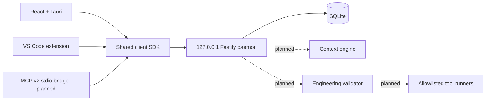

# Architecture

`contracts` owns Zod schemas, types and API envelopes. `client-sdk` owns transport, validation, timeouts, token headers and errors. The daemon owns routing, startup, token lifecycle and project orchestration. `event-store` owns forward-only migrations and platform persistence; it exports async repository ports for Developer 2's algorithms. `context-engine` depends on contracts and receives repositories through interfaces. `mcp-gateway` depends on contracts, the client SDK and official MCP v2 server SDK; it calls the daemon rather than SQLite. `engineering-core` depends on contracts and tool-runner interfaces. `tool-runners` has no network/UI dependency. `ui` is presentational React only; it never calls the API.

Dependency direction: apps → SDK/shared packages → contracts. Server-side modules may be composed in the daemon after review. Do not import apps from packages or frontend code into server packages. Context and engineering never obtain implicit global project state. Keep package dependency edges explicit in manifests.

The daemon binds 127.0.0.1, logs route templates/request UUID/status without bodies, query strings or tokens, and gracefully closes SQLite on SIGINT/SIGTERM. Existing workspace directories are canonicalized before insertion. SQLite enables WAL, foreign keys and a busy timeout; newer unknown migration versions refuse to open. Data persists through restarts. Deleting a project deletes its activity events by FK cascade; it never deletes workspace files.

Available integration: health/project CRUD plus persisted events, context records, handoffs, global MCP inventory and completed validation results over the shared SDK. ContextEngine can be injected through the daemon integration factory. Planned integration: validation orchestration and MCP execution/health checks remain 501 until Developer 2's implementations are composed with these persistence ports. See ADR 0002 and INTEGRATION_PERSISTENCE.
